# Software Architecture & System Design Practical Case Studies

## Introduction to Software Architecture & System Design

This section outlines the foundational concepts and a step-by-step process for system design. A key takeaway is that there is no single "correct" solution for any given system design problem. The process involves:

1. Gathering Functional and Non-Functional Requirements
2. Defining the system's API and the sequence of events
3. Designing to meet those requirements

## Design a Highly Scalable Image Sharing Social Media Platform

This case study focuses on designing a platform similar to Instagram or Flickr, capable of handling a massive number of users and images.

### Sequence Diagram and System's API

This diagram illustrates the flow of key user actions, from registration to viewing a timeline.

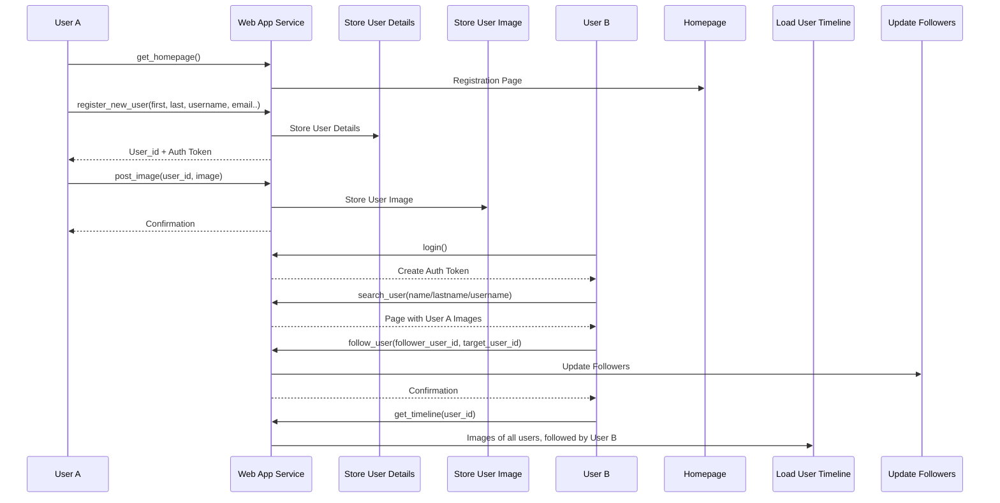

**Explanation:** The sequence diagram shows two main workflows. The first is for User A registering and posting an image. The second is for User B, who logs in, searches for User A, follows them, and then requests their personal timeline. This highlights the core API calls and the interaction between a user and the Web App Service.

### Functional Software Architecture Diagram

This diagram shows the initial breakdown of the system into key services and their data stores.

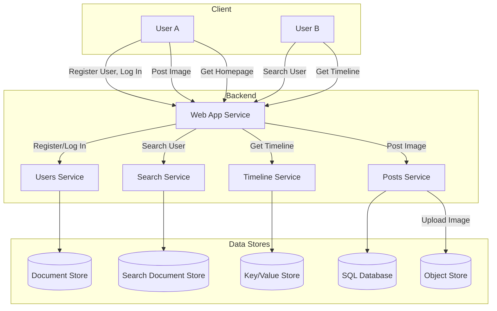

**Explanation:** The functional diagram presents a microservices-based architecture. The Web App Service acts as a central entry point. Specific services handle different domain functionalities: Users Service for user data, Search Service for searching, Timeline Service for user feeds, and Posts Service for handling image posts. Each service uses a data store optimized for its specific task.

### Final Software Architecture Diagram

This final diagram refines the architecture by adding an API Gateway, a CDN, and an Image Processing Pipeline to handle scalability and performance.

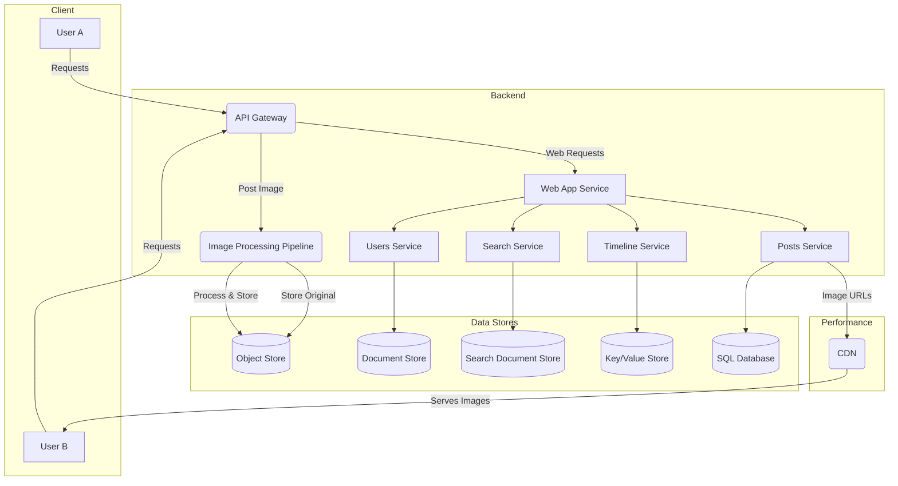

**Explanation:** The addition of an API Gateway provides a single entry point for all client requests, handling authentication and routing. The Image Processing Pipeline is a critical component for scalability, as it asynchronously processes uploaded images (resizing, watermarking, etc.) to optimize them for various devices. Finally, a Content Delivery Network (CDN) is used to cache and deliver images and other static assets to users globally, reducing latency and load on the main servers.

## Design a Video-On-Demand (VOD) Streaming Service

This section covers the architecture of a VOD service like Netflix or YouTube.

### Sequence Diagram and API

This diagram shows the core user flows for both viewers and content creators.

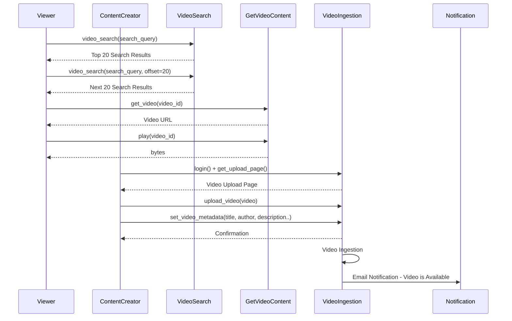

**Explanation:** The diagram shows the request-response cycle for a viewer searching for and playing a video. For a content creator, it outlines the video upload process, from logging in and getting the upload page to setting metadata and receiving a final confirmation.

### Functional Software Architecture Diagram

This diagram outlines the initial functional services and data flow.

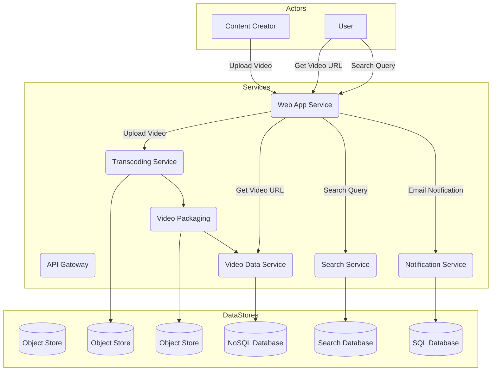

**Explanation:** The architecture is designed for the unique challenges of video. A Transcoding Service converts uploaded videos into multiple formats and resolutions. Video Packaging prepares the transcoded videos for streaming. A dedicated Video Data Service manages video metadata, and a Search Service handles search queries.

### Final Software Architecture Diagram

This diagram adds a CDN for efficient video delivery.

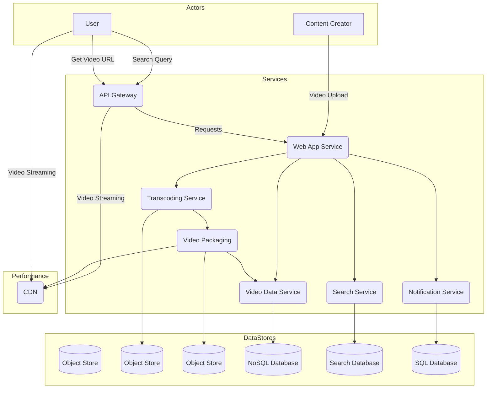

**Explanation:** The final architecture incorporates a CDN for both static assets and the transcoded video files, which are the most bandwidth-intensive part of the application. This ensures low-latency video streaming to viewers worldwide by caching video segments at edge locations close to the users.

## Design a Highly Scalable, Real-Time Instant Messaging Service

This case study focuses on designing a messaging platform like WhatsApp or Slack.

### Sequence Diagram and System's API

This diagram shows the flow of signup, login, and message sending.

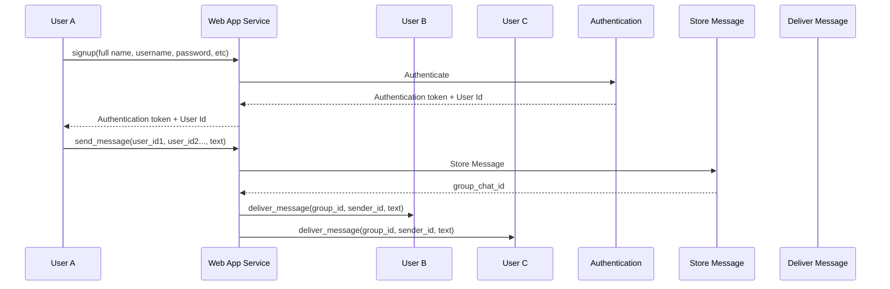

**Explanation:** This diagram illustrates the core API calls and message flow. It shows how a user signs up and gets an authentication token. Then, when a message is sent, it is stored in the system and delivered to the intended recipients.

### Functional Software Architecture Diagram

This diagram shows the initial breakdown of services for an instant messaging platform.

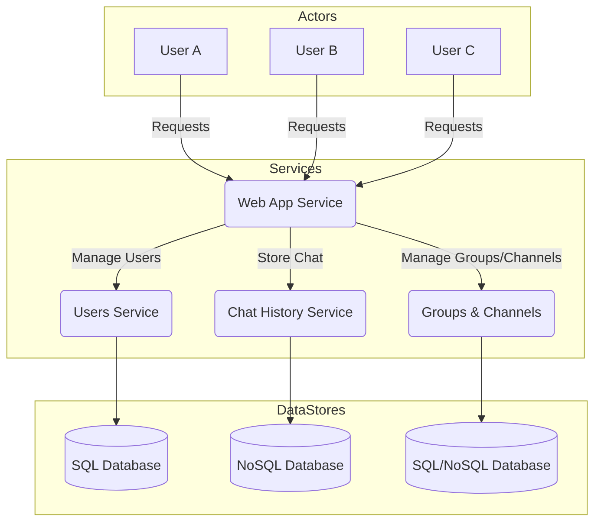

**Explanation:** This architecture separates concerns into specialized services. The Users Service handles user data, Chat History Service stores and retrieves messages, and Groups & Channels manages the metadata for different chat rooms.

### Final Software Architecture Diagram

This diagram adds components crucial for real-time messaging, such as an API Gateway and a Connection Management service.

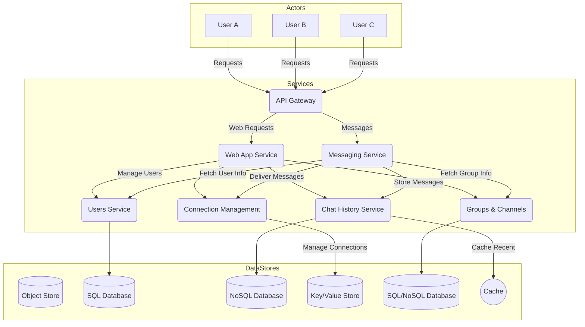

**Explanation:** The API Gateway routes requests. The new Messaging Service is the core of the real-time functionality, handling the delivery and storage of messages. The Connection Management service is crucial for maintaining persistent connections with millions of users, often using technologies like WebSockets, and a Key/Value store to track which users are online and on which server. A Cache is added to improve performance for frequently accessed chat history.

## Design a Typeahead / Autocomplete for a Search Engine

This section focuses on designing a service that provides search suggestions as a user types.

### Functional Software Architecture Diagram

This diagram shows the components required to generate and serve typeahead suggestions.

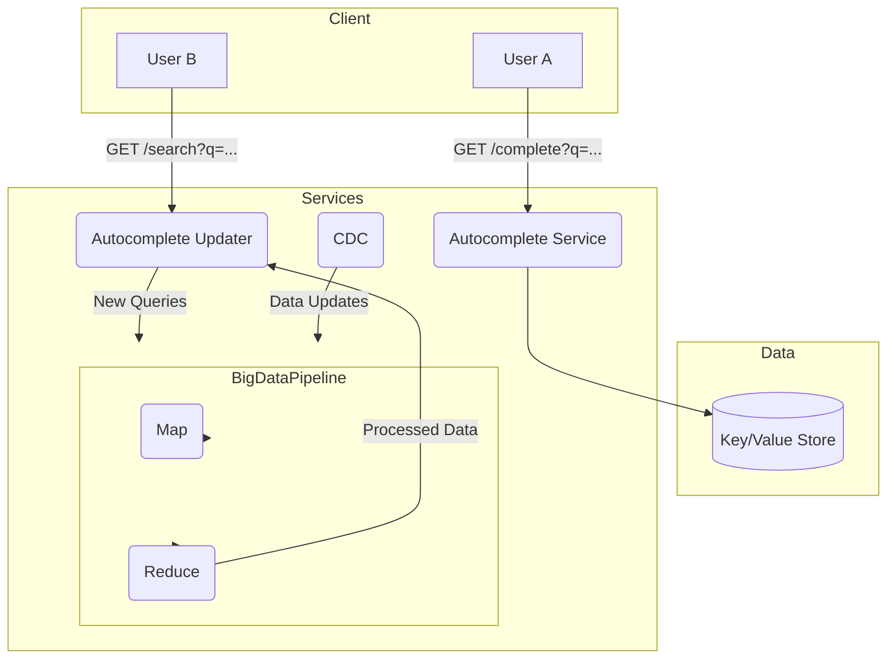

**Explanation:** The system is split into two main flows. The "read path" is for User A, who interacts with the Autocomplete Service to get suggestions from a fast Key/Value Store. The "write path" is for User B, whose search queries are fed into a Big Data Processing Pipeline via the Autocomplete Updater. This pipeline uses MapReduce to process new data and update the suggestions. CDC (Change Data Capture) is also used to capture and process updates from other parts of the search system.

### Final Software Architecture Diagram

This diagram refines the Big Data Processing Pipeline and storage.

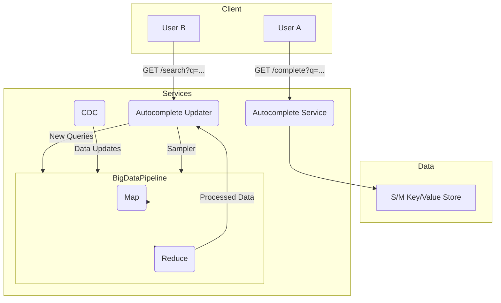

**Explanation:** In this version, the Autocomplete Updater includes a Sampler to only process a representative sample of search queries, reducing the load on the Big Data Processing Pipeline. The Key/Value Store is now explicitly labeled as S/M (sharded and master/replica) to highlight the need for a highly available, distributed data store to handle the high-volume read traffic.

## Design a Scalable Ride Sharing Service

This section outlines the architecture of a service like Uber or Lyft.

### Sequence Diagram and System's API

This diagram shows the flow for both drivers joining the service and riders requesting a trip.

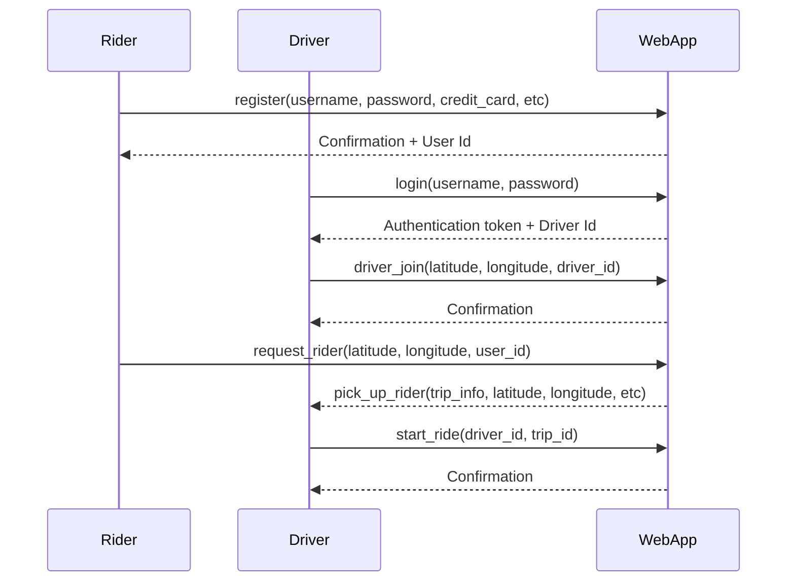

**Explanation:** The sequence diagram shows the core business logic. First, a driver logs in and joins the "pool" of available drivers. Then, a rider requests a trip, which triggers the system to find and notify a nearby driver. The diagram also includes the process of location updates, which are critical for real-time tracking.

### Functional Software Architecture Diagram

This diagram breaks down the rideshare service into a set of core services.

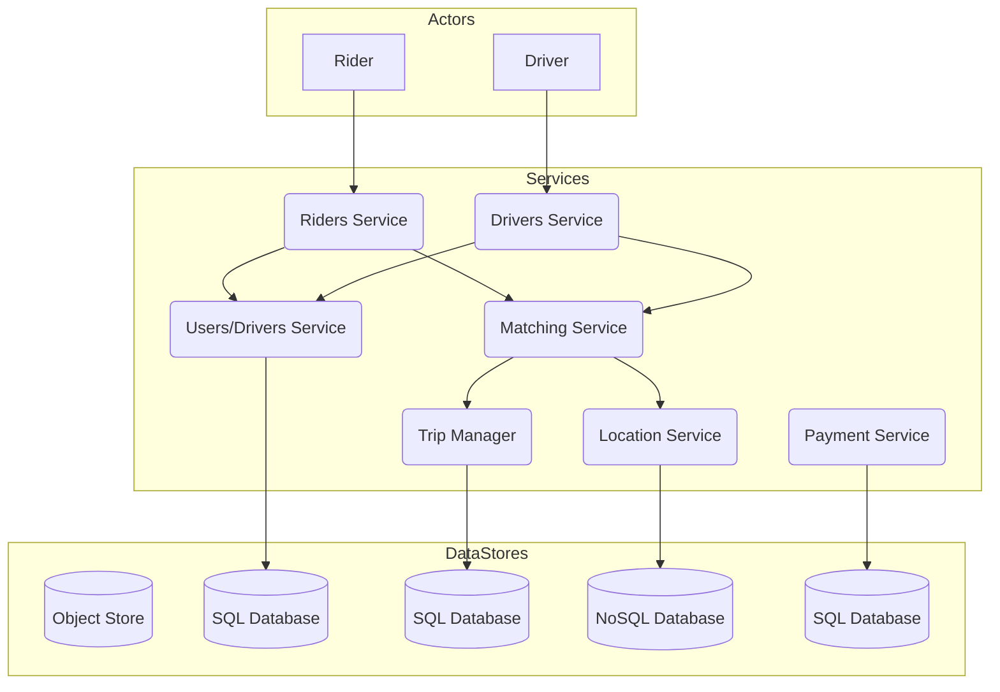

**Explanation:** The Riders Service and Drivers Service handle user and driver-specific functionalities. The Matching Service is the brain of the operation, pairing riders with drivers based on location and availability. The Location Service tracks real-time location data, and the Trip Manager handles the lifecycle of a trip.

### Final Software Architecture Diagram

This diagram adds services for notifications and map generation.

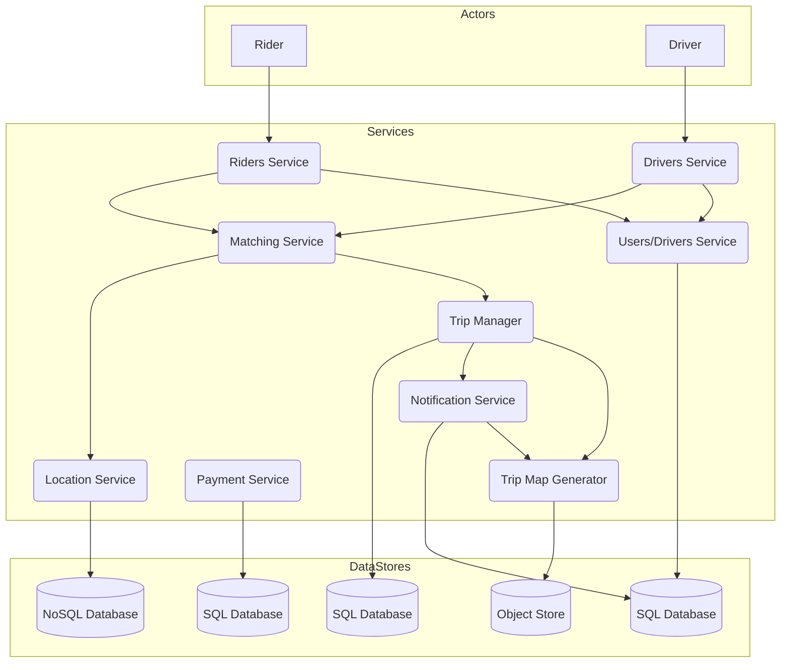

**Explanation:** The final architecture includes a Notification Service to send push notifications or emails to users and drivers (e.g., "Your driver has arrived!"). A Trip Map Generator is added to create a visual representation of the trip, which can be sent as part of the ride receipt.

### Adding a Bloom Filter to the Users Service

This section explains how a Bloom filter can be used to quickly check if a username exists, minimizing database lookups for non-existent users.

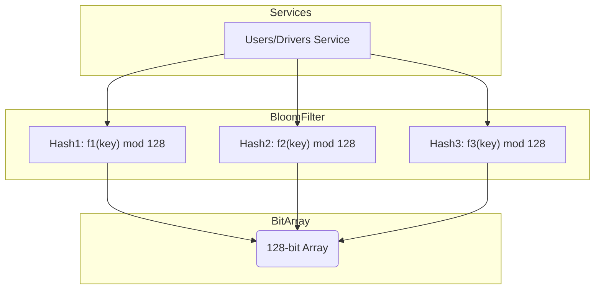

**Explanation:** A Bloom filter is a probabilistic data structure used to test for membership. When a user checks if a username is available, the system doesn't have to hit the database every time. Instead, it runs the potential username through several independent hash functions. The output of each hash function corresponds to a bit in a large bit array. If all the bits are set to 1, the username may exist. If even one bit is 0, the username definitely does not exist. This is a powerful optimization, as database calls are expensive.

### Adding Geohash

**Explanation:** Geohash is a geocoding system that encodes a location (latitude and longitude) into a short string of letters and digits. A key feature of Geohash is that locations that are close to each other have a similar Geohash prefix. This property is incredibly useful for a rideshare service, as it allows for efficient searching of nearby drivers. Instead of searching a massive database for all drivers within a certain radius, the system can simply search for drivers whose location data (stored as a Geohash) shares a similar prefix with the rider's location. This makes finding the closest drivers much faster and more scalable.

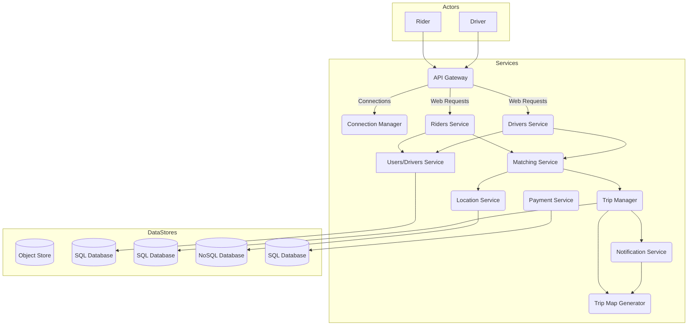
