# Cloud Computing Software Architecture Patterns

This document outlines various software architecture patterns for cloud computing, providing detailed explanations, typical use cases, and visual representations using Mermaid diagrams.

## Scalability Patterns

### 1. Load Balancing Pattern

**Explanation:** The Load Balancing Pattern helps leverage the "infinite" access to cloud computing resources by distributing incoming client requests across multiple instances of a service. This prevents any single instance from becoming a bottleneck, improving performance, availability, and scalability. It typically involves a dispatcher that directs traffic to various worker instances.

**Use Case:** A high-traffic e-commerce website needs to handle millions of concurrent users. A load balancer distributes incoming user requests across multiple web server instances, ensuring that no single server is overloaded and providing a smooth shopping experience even during peak sales events.

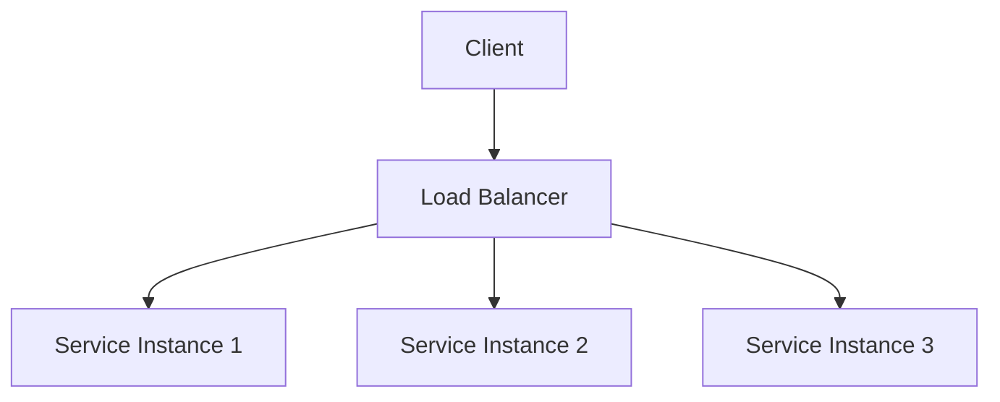
### 2. Pipes and Filters Pattern: 

**Explanation:** This pattern structures a system into a series of independent processing steps (filters) where the output of one step becomes the input of the next (pipes). Each filter performs a specific transformation on the data, and the pipes are often implemented using message queues, allowing for different programming languages for each filter and parallel execution.

**Use Case:** An image processing pipeline where an uploaded image goes through several stages:
1. Filter 1 (Resizing): Resizes the image to a standard dimension.
2. Filter 2 (Watermarking): Adds a watermark to the image.
3. Filter 3 (Compression): Compresses the image for storage.Each filter can be an independent service, potentially running on different hardware or using different languages, processing images from a queue.

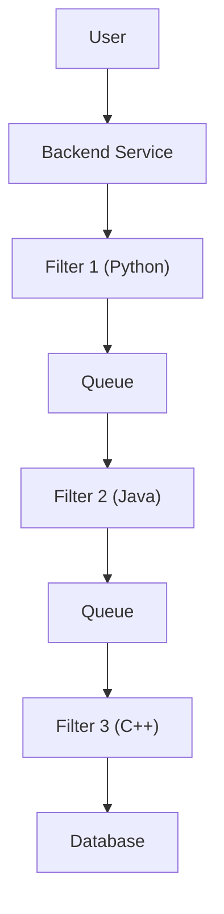

### 3. Scatter Gather Pattern

**Explanation:** The Scatter Gather pattern is used when a request needs to be processed by multiple independent workers in parallel, and then their individual responses are aggregated to form a single, comprehensive response. A dispatcher sends the request to all workers and then gathers and combines their results.

**Use Case:** A product search engine that needs to query multiple different product catalogs (e.g., electronics, books, apparel) from various microservices. A dispatcher sends the search query to each catalog service in parallel, gathers all the results, and then combines them into a single list presented to the user.

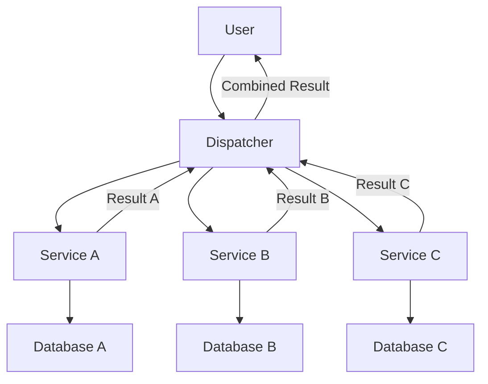

### 4. Execution Orchestrator Pattern

**Explanation:** This pattern addresses the challenge of running complex, multi-step business flows across several microservices. A centralized "orchestration service" acts as the brain, explicitly defining and managing the sequence of operations, their context, and handling issues like retries.

**Use Case:** An online order fulfillment process:
1. Order Service: Receives the order.
2. Payment Service: Processes payment.
3. Inventory Service: Checks and reserves stock.
4. Shipping Service: Arranges delivery.
   
An orchestration service manages this flow, ensuring each step completes successfully and handling retries if a service temporarily fails.
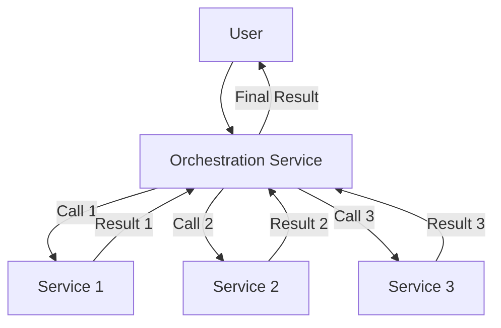

### 5. Choreography Pattern

**Explanation:** In contrast to orchestration, the Choreography pattern uses an event-driven architecture to manage business flows across services. Services react to events published by other services, without a central coordinator. This reduces tight coupling between microservices.

**Use Case:** An e-commerce system where an order creation triggers a series of actions:
1. Order Service publishes an "OrderCreated" event.
2. Inventory Service listens to "OrderCreated" and updates stock.
3. Payment Service listens to "OrderCreated" and processes payment.
4. Notification Service listens to "OrderCreated" and sends a confirmation email.

Each service acts independently based on events, rather than being directed by a central orchestrator.

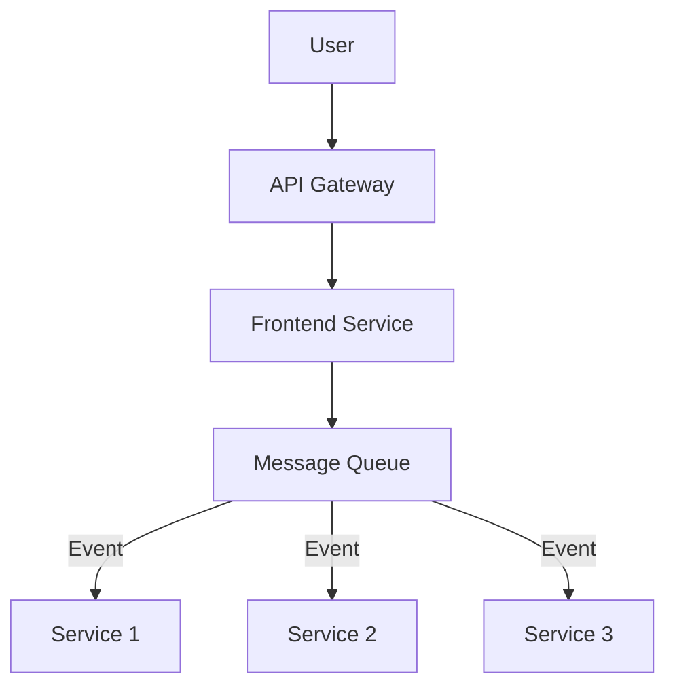

## Performance Patterns for Data-Intensive Systems

### 1. Map Reduce Pattern

**Explanation:** This pattern is designed for running computations on very large datasets. It involves two main phases:

1. Map: Processes input data (often key/value pairs) to generate intermediate key/value pairs.
2. Reduce: Groups and aggregates the intermediate key/value pairs to produce final results.The pattern reuses an execution framework that handles distributed processing, fault tolerance, and data partitioning.

**Use Case:** Analyzing website logs to count the number of unique visitors per day.

1. Map: Each log entry is processed to extract the user ID and the date, outputting (date, user_id) pairs.
2. Reduce: All (date, user_id) pairs are grouped by date, and then the unique user IDs for each date are counted to get the total unique visitors for that day.

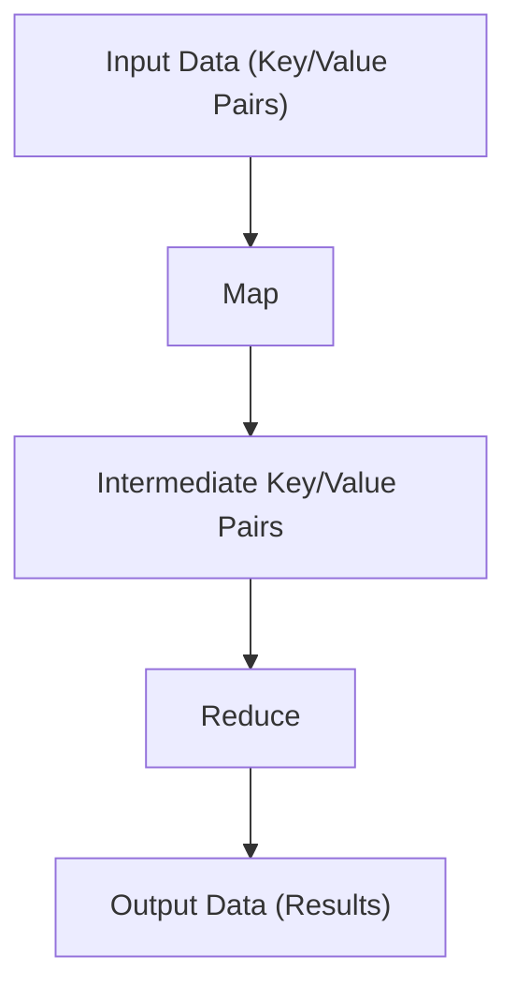
### 2. The Saga Pattern
**Explanation:** The Saga pattern addresses the challenge of maintaining ACID (Atomicity, Consistency, Isolation, Durability) properties in distributed transactions across multiple microservices, where a traditional two-phase commit is not feasible. A saga is a sequence of local transactions, where each transaction updates its own database and publishes an event. If a transaction fails, compensating transactions are executed to undo the changes made by preceding successful transactions.

**Use Case:** A distributed order processing system:
1. Order Service: Creates an order (local transaction) and publishes an "OrderCreated" event.
2. Payment Service: Processes payment (local transaction) and publishes a "PaymentProcessed" event.
3. Inventory Service: Deducts stock (local transaction).If the Inventory Service fails to deduct stock, compensating transactions are triggered: Payment Service refunds the payment, and Order Service cancels the order.M

```mermaid
graph TD
    subgraph Success Scenario
        Service1_Op1[Service 1: Operation 1] --> Service2_Op2[Service 2: Operation 2];
        Service2_Op2 --> Service3_Op3[Service 3: Operation 3];
        Service3_Op3 --> Success[Success];
    end

    subgraph Failure Scenario
        Service1_Op1_Fail[Service 1: Operation 1] --> Service2_Op2_Fail[Service 2: Operation 2];
        Service2_Op2_Fail -- Failure --> Service3_Fail[Service 3: Failure];
        Service3_Fail --> Service2_Comp[Service 2: Compensating Op 2];
        Service2_Comp --> Service1_Comp[Service 1: Compensating Op 1];
        Service1_Comp --> Abort[Abort];
    end
```

### 3. Transactional Outbox Pattern

**Explanation:** This pattern solves the problem of ensuring atomicity between a database operation and publishing an event, especially when they cannot be part of a single distributed transaction. It involves storing outgoing events in a dedicated "outbox" table within the same database transaction as the business data update. A separate "message relay service" then monitors this outbox table and publishes the events to a message queue.

**Use Case:** A user registration service where, upon successful user creation in the database, a "UserCreated" event needs to be published to a message queue for other services to consume (e.g., a welcome email service). The user creation and event recording happen in a single database transaction. A message relay service then picks up the event from the outbox table and publishes it.

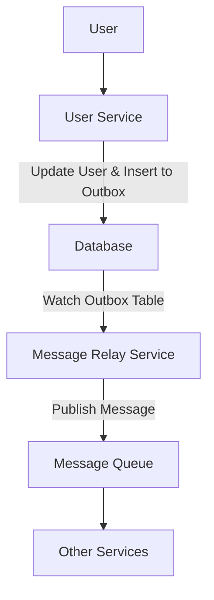

### 4.  Materialized View Pattern

**Explanation:** The Materialized View pattern addresses low efficiency and performance of complex database queries, especially those involving joins or aggregations over large datasets. It involves creating a read-only "materialized view" table that pre-computes and stores the result of a complex query. This view is periodically updated (or updated on demand) from the raw data tables, allowing applications to query the view directly for faster access.

**Use Case:** An analytics dashboard that displays daily sales reports, requiring complex joins and aggregations of sales, product, and customer data. Instead of running the complex query every time the dashboard is loaded, a materialized view is created nightly, containing the pre-calculated sales report. The dashboard then queries this fast, read-only view.

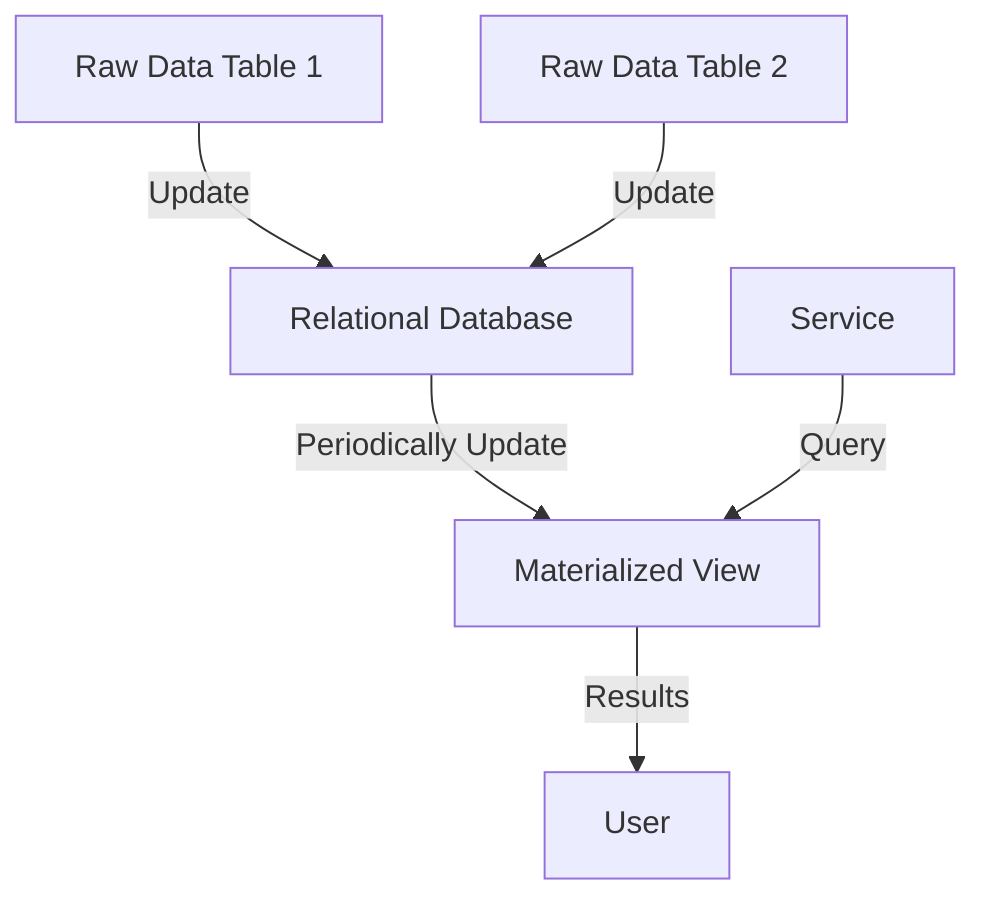

### 5.  CQRS Pattern

**Explanation:** CQRS (Command and Query Responsibility Segregation) separates the responsibilities of data mutation (commands) and data reading (queries) into distinct services and often distinct data models or databases. This addresses the problem of tight coupling between command and query operations in a single microservice, allowing for independent scaling and optimization of read and write operations.

**Use Case:** A social media application where user profiles are frequently read but updated less often.Command Service: Handles profile updates (e.g., changing bio, profile picture) and writes to a Command DB.Query Service: Handles requests to view profiles and reads from a Query DB, which might be optimized for fast reads (e.g., a denormalized NoSQL database). Data is synchronized between the two databases.

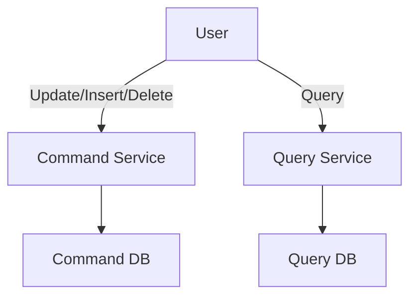

### 6.  CQRS + Materialized View for Microservices Architecture

**Explanation:** This pattern combines CQRS and Materialized View to solve the problem of performing "join" operations on data distributed across different microservices, which is typically not supported in microservices architectures. By using CQRS, command and query responsibilities are separated. A materialized view is then created, often in the query database, to aggregate and denormalize data from multiple microservices' databases, making complex queries efficient.

**Use Case:** An e-commerce platform with separate microservices for Products, Orders, and Customers. To display a user's order history, including product details and customer information, a direct join across microservice databases isn't possible.CQRS is used for each microservice.A Materialized View is built in the Query Database of the Order service (or a dedicated reporting service) that aggregates relevant product and customer data from their respective query databases, allowing fast retrieval of comprehensive order details.

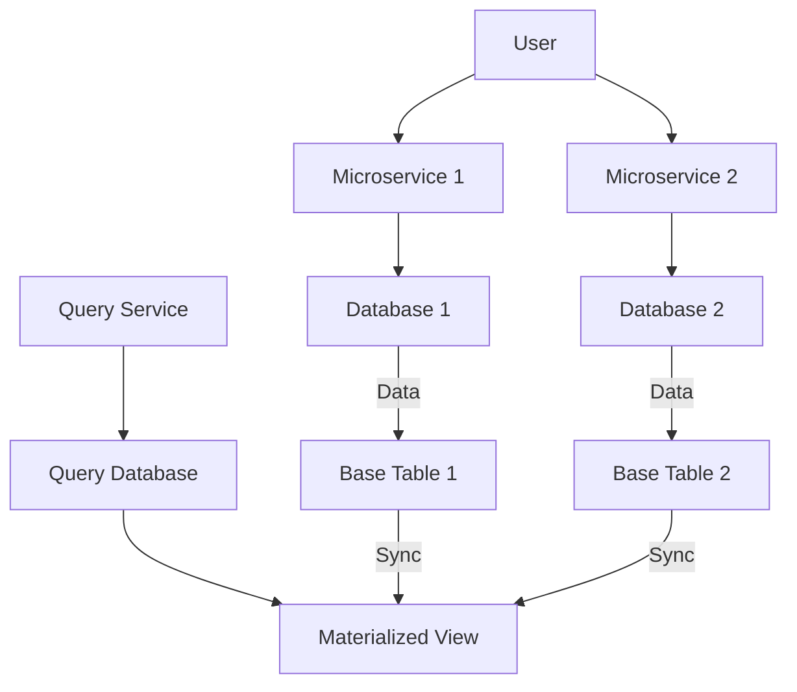

### 7.  Event Sourcing Pattern

**Explanation:** Instead of storing only the current state of an entity (which CRUD operations overwrite), the Event Sourcing pattern stores the full sequence of events that led to the current state. Every change to the application state is captured as an event and appended to an immutable sequence (an event log). The current state can be reconstructed by replaying these events. This pattern provides a complete audit trail and enables powerful temporal queries.

**Use Case:** A financial trading application where every transaction (buy, sell, deposit, withdrawal) is recorded as an event. To determine an account's balance at any point in time, the system replays all events up to that specific time. This also allows for easy auditing and debugging.

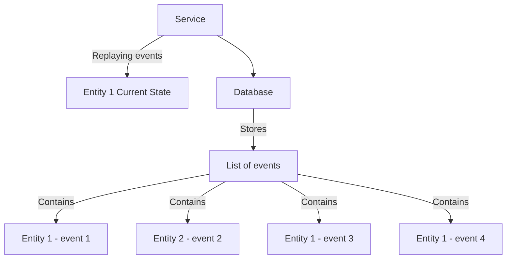

## Software Extensibility Architecture Patterns

### 1.  Sidecar & Ambassador Pattern

**Explanation:** This pattern addresses the problem of common functionality (like logging, monitoring, security) being shared across many services, which can lead to tight coupling if implemented as shared libraries. It involves deploying a "sidecar" process alongside the main application on the same host. The sidecar handles the shared functionality, abstracting it away from the main application. An "Ambassador" is a specific type of sidecar that proxies network requests, managing communication between the main application and external services.

**Use Case (Sidecar):** A microservice application needs distributed logging. Instead of each microservice implementing its own logging logic and sending logs to a central logging service, a sidecar container runs alongside each microservice. The microservice writes logs to a local file, and the sidecar picks up these logs and forwards them to the distributed logging service.

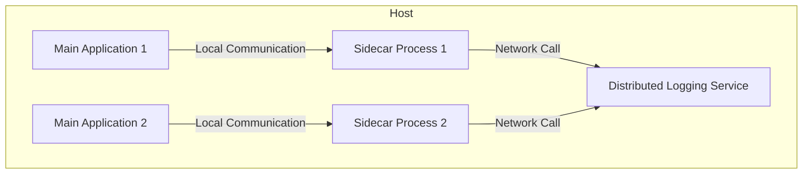

### 2.  Anti-Corruption Adapter Pattern

**Explanation:** This pattern is used to prevent the "corruption" of a new system (or a new part of a system) by the old, often legacy, system's outdated APIs, data models, or technologies. An "anti-corruption adapter" service acts as a translation layer between the new and old systems, converting data models and API calls from the new system's preferred format to the old system's format, and vice versa.Use Case: A company is migrating from a monolithic legacy e-commerce system to a new microservices-based architecture. The new Order microservice needs to interact with the old Inventory system. An Anti-Corruption Adapter service sits between them, translating the modern API calls and data structures from the new Order service into the format expected by the legacy Inventory system, and converting the legacy responses back for the new service.Mermaid Diagram:graph TD
    subgraph New Part of System
        Microservice1[Microservice 1] --> AntiCorruptionService[Anti-Corruption Service];
        Microservice2[Microservice 2] --> AntiCorruptionService;
        Microservice3[Microservice 3] --> AntiCorruptionService;
        Database1[Database] -- Data --> Microservice1;
        Database2[Database] -- Data --> Microservice2;
        Database3[Database] -- Data --> Microservice3;
    end

    subgraph Old Part of System
        AntiCorruptionService -- OLD Models, APIs, technology --> MonolithicApplication[Monolithic Application];
        MonolithicApplication --> MonolithicDatabase[Monolithic Database];
    end
2.  Backends for Frontends PatternExplanation: This pattern suggests creating a separate backend service for each type of frontend application (e.g., web, iOS, Android). This addresses the problem where a single, unified backend might not fully leverage the unique capabilities or data requirements of different frontend types, leading to inefficient APIs or complex client-side logic. Each "Backend for Frontend" (BFF) can be optimized for its specific client, providing tailored APIs and data transformations.Use Case: A media streaming service has a web application, an iOS app, and an Android app. Each client has different UI layouts, data needs, and network constraints. Instead of a single backend, there's:A Web Backend optimized for browser-specific interactions and data.An iOS Backend providing a lean API tailored for the iOS app.An Android Backend providing an API optimized for the Android app.All BFFs interact with the same core microservices (e.g., Content Service, User Service).Mermaid Diagram:graph TD
    WebFrontend[Web Frontend] --> WebBackend[Web Backend];
    IOSFrontend[iOS Frontend] --> IOSBackend[iOS Backend];
    AndroidFrontend[Android Frontend] --> AndroidBackend[Android Backend];

    WebBackend --> Service1[Service 1];
    WebBackend --> Service2[Service 2];
    IOSBackend --> Service1;
    IOSBackend --> Service3[Service 3];
    AndroidBackend --> Service1;
    AndroidBackend --> Service2;
    AndroidBackend --> Service3;
3.  Throttling and Rate Limiting PatternExplanation: This pattern is used to control the rate at which a client or user can access an API or service. It prevents potential overconsumption of system resources, protects against denial-of-service attacks, and manages usage of external APIs. It sets a limit on the number of requests allowed within a specific time window.Use Case: A public API for weather data. To prevent abuse and ensure fair usage, the API implements rate limiting, allowing each client only 100 requests per minute. If a client exceeds this limit, subsequent requests are rejected until the next time window.Mermaid Diagram:graph TD
    Client[Client] -- Requests --> Service[Service (Requests limited by Bandwidth)];
    Service --> Database[Database];
4.  Retry PatternExplanation: The Retry pattern addresses transient faults (temporary software errors, hardware glitches, network issues) that can occur in distributed systems. When a service call fails due to such a fault, the client (or an intermediary) automatically retries the request after a short delay. This pattern improves the reliability of interactions by allowing temporary issues to resolve themselves.Use Case: A microservice calls an external payment gateway. If the first attempt fails due to a temporary network glitch, the service automatically retries the payment request a few times with increasing delays before reporting a permanent failure to the user.Mermaid Diagram:graph TD
    Client[Client] -- Request --> Service[Service];
    Service -- Resend request (Retry) --> OtherService[Other Service];
    OtherService -- Failure (Transient) --> Service;
    Service -- Success --> Client;
5.  Circuit Breaker PatternExplanation: The Circuit Breaker pattern prevents an application from repeatedly trying to execute an operation that is likely to fail, thereby saving resources and improving the application's responsiveness. When a service experiences a certain number of failures within a threshold, the circuit "opens," preventing further calls to that service. After a timeout, it moves to a "half-open" state to test if the service has recovered, and then either closes (if successful) or re-opens (if still failing).Use Case: An online dating service that relies on an external Image Service to load user photos. If the Image Service starts returning errors frequently, the Circuit Breaker for the Image Service opens. The main application then stops trying to call the Image Service, perhaps displaying placeholder images instead, preventing a cascade of failures and allowing the Image Service time to recover.Mermaid Diagram:graph TD
    User --> MainApplication[Main Application (Online Dating Service)];
    MainApplication -- Calls --> CircuitBreaker[Circuit Breaker];
    CircuitBreaker -- Open (1 response, 20 errors) --> ImageService[Image Service];
    CircuitBreaker -- Closed --> ProfileService[Profile Service];
6.  Dead Letter Queue (DLQ) PatternExplanation: A Dead Letter Queue (DLQ) is a special queue in a message broker that holds messages that cannot be successfully processed or delivered to their intended destination. Messages can end up in a DLQ due to various reasons, such as invalid format, processing errors, or exceeding retry limits. The DLQ provides a mechanism to isolate problematic messages for later inspection, debugging, or manual intervention, preventing them from blocking the main processing flow.Use Case: An order processing system uses a message queue for new orders. If an order message is malformed or if the Order Service fails to process it after multiple retries, the message is automatically moved to a Dead Letter Queue. An operations team can then inspect the DLQ, fix the problematic messages, and re-inject them into the system.Mermaid Diagram:graph TD
    User --> APIGateway[API Gateway];
    APIGateway --> OrderService[Order Service];
    OrderService -- Publish Message --> MessageBroker[Message Broker];
    MessageBroker -- Physical Goods --> InventoryService[Inventory Service];
    MessageBroker -- Digital Assets --> PaymentService[Payment Service];
    MessageBroker -- If processing fails --> DeadLetterQueue[Dead Letter Message Broker (Dead Letter)];
    DeadLetterQueue --> FulfillmentService[Fulfillment Service (for inspection/reprocessing)];
7.  Rolling DeploymentExplanation: Rolling deployment is a strategy where a new version of an application is gradually deployed by replacing instances of the old version with instances of the new version, one by one or in small batches. During the deployment, both old and new versions of the application are running simultaneously. This minimizes downtime and risk, as issues with the new version can be detected early, and the deployment can be paused or rolled back.Use Case: An online banking application needs an update. Instead of taking the entire system offline, a rolling deployment is used. New instances with the updated application are brought online and added to the load balancer, while old instances are gracefully shut down and removed. This ensures continuous availability for users.Mermaid Diagram:graph TD
    User --> LoadBalancer[Load Balancer];
    subgraph Old Version
        LoadBalancer --> Instance1_Old[Instance 1];
        LoadBalancer --> Instance2_Old[Instance 2];
        LoadBalancer --> Instance3_Old[Instance 3];
    end
    subgraph New Version (Upgrading)
        LoadBalancer --> Instance4_New[Instance 4];
        LoadBalancer --> Instance5_New[Instance 5];
        LoadBalancer --> Instance6_New[Instance 6];
    end
    Instance1_Old -- Replaced By --> Instance4_New;
    Instance2_Old -- Replaced By --> Instance5_New;
    Instance3_Old -- Replaced By --> Instance6_New;
8.  Blue-Green DeploymentExplanation: Blue-Green deployment is a technique that reduces downtime and risk by running two identical production environments, "Blue" (current live version) and "Green" (new version). At any time, only one environment is live. When deploying a new version, it's deployed to the inactive environment (e.g., Green). Once tested, traffic is switched from Blue to Green instantly via a load balancer. If issues arise, traffic can be immediately switched back to Blue.Use Case: A critical financial trading platform needs a new feature deployed with zero downtime. The current version runs on the "Blue" environment. The new version is deployed and thoroughly tested on the "Green" environment. Once validated, the load balancer is reconfigured to direct all traffic to "Green." If any critical bug is found post-switch, traffic is instantly reverted to "Blue."Mermaid Diagram:graph TD
    User --> LoadBalancer[Load Balancer];
    subgraph Blue Environment (Old Version)
        LoadBalancer -- Current Traffic --> Instance1_Blue[Instance 1];
        LoadBalancer -- Current Traffic --> Instance2_Blue[Instance 2];
        LoadBalancer -- Current Traffic --> Instance3_Blue[Instance 3];
    end
    subgraph Green Environment (New Version - deployed onto green instances)
        LoadBalancer -- Switch Traffic To --> Instance4_Green[Instance 4];
        LoadBalancer -- Switch Traffic To --> Instance5_Green[Instance 5];
        LoadBalancer -- Switch Traffic To --> Instance6_Green[Instance 6];
    end
9.  Canary Release PatternExplanation: Canary Release is a deployment strategy that gradually rolls out a new version of an application to a small subset of users before making it available to the entire user base. This allows for real-world testing and monitoring of the new version with minimal impact. If the canary release performs well, it's rolled out to more users; otherwise, it's quickly rolled back.Use Case: A social media platform wants to test a new algorithm for its news feed. Instead of deploying it to all users, the new algorithm is deployed to "canary servers." A small percentage of users (e.g., 5% of beta users) are routed to these canary servers via the load balancer. The team monitors metrics (e.g., error rates, user engagement) for this group. If successful, the new algorithm is gradually rolled out to more users.Mermaid Diagram:graph TD
    User[User] --> LoadBalancer[Load Balancer];
    BetaUser[Beta User] --> LoadBalancer;

    subgraph Current Servers
        LoadBalancer -- Most Traffic --> Instance1[Instance 1];
        LoadBalancer -- Most Traffic --> Instance2[Instance 2];
        LoadBalancer -- Most Traffic --> Instance3[Instance 3];
    end

    subgraph Canary Servers (Updated)
        LoadBalancer -- Small Traffic --> Instance4[Instance 4];
        LoadBalancer -- Small Traffic --> Instance5[Instance 5];
        LoadBalancer -- Small Traffic --> Instance6[Instance 6];
    end
10. A/B Testing PatternExplanation: A/B Testing (also known as split testing) is a method of comparing two versions of a webpage or app feature against each other to determine which one performs better. Users are randomly divided into groups (A and B), with each group experiencing a different version. Metrics (e.g., conversion rates, click-through rates) are collected and analyzed to decide which version is more effective.Use Case: An online store wants to test two different recommendation algorithms.Group A (Control): Customers are shown recommendations from the existing algorithm.Group B (Experiment): Customers are shown recommendations from the new algorithm (deployed on "Servers with New Feature").The load balancer routes customers to the appropriate server group, and the store monitors which group generates more sales or higher engagement to determine the better algorithm.Mermaid Diagram:graph TD
    CustomerA[Customer (A Group)] --> LoadBalancer[Load Balancer];
    CustomerB[Customer (B Group)] --> LoadBalancer;

    subgraph Online Store Recommendation Service
        LoadBalancer -- Route to A --> Instance1[Instance 1];
        LoadBalancer -- Route to A --> Instance2[Instance 2];
        LoadBalancer -- Route to A --> Instance3[Instance 3];
        LoadBalancer -- Route to B --> Instance4[Instance 4 (Servers with New Feature)];
        LoadBalancer -- Route to B --> Instance5[Instance 5 (Servers with New Feature)];
        LoadBalancer -- Route to B --> Instance6[Instance 6 (Servers with New Feature)];
    end
11. Chaos Engineering PatternExplanation: Chaos Engineering is the discipline of experimenting on a system in production in order to build confidence in the system's ability to withstand turbulent conditions. It involves deliberately injecting failures (e.g., network latency, service outages, resource exhaustion) into a production system to identify weaknesses and validate the system's resilience and recovery mechanisms.Use Case: A company wants to ensure its microservices architecture can handle service failures. They deliberately inject latency into the network connection of a specific microservice or shut down an instance of a database. By observing how the system reacts and recovers, they can identify and fix vulnerabilities before they cause real outages.Mermaid Diagram:graph TD
    User --> LoadBalancer[Load Balancer];
    subgraph Production System
        LoadBalancer --> Service[Service];
        Service --> Instance1[Instance 1];
        Service --> Instance2[Instance 2];
        Service --> Instance3[Instance 3];
        Instance1 --> Database[Database];
        Instance2 --> Database;
        Instance3 --> Database;
        Service -- Deliberately injecting failures --> Monitoring[Monitoring & Plan to fix issues];
    end
