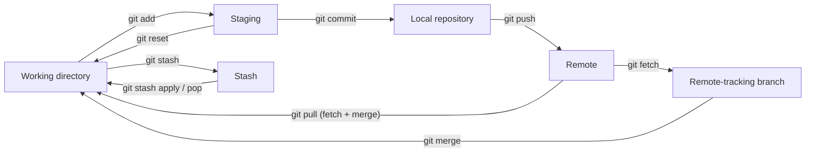

```bash
git init  #init repository
git status

```

Para tracker los comabios a un archivos

git add
git log <- todo el historial de commits>

git rm file --cached

git checkout para cambiar entre los commit
git checkout SHA


git config 
git config --list
git config --global user.name
git config --global user.email

git branch

git show <- muestra lo que se modifico de un commit a otro

git add .
git diff sha1 sha2  <- comparar diferencias


comentarios multilinea con `git commit`

## Cambio de branches 
- git checkout cha
- cambio en el archivo
- git stac

# Inicializar el repositorio
Dentro de la carpeta
git init inicializa el repositorio con un archivo .git y un area en RAM de staging

1. git add agrega a staging
2. git commit -m "" 

Master (main) <- todos los cambios y la version definitiva>

# Ramas

Master es la referencia al último commit

`git reset` : código del commit --hard. git reset, resetea  a como estaban todos los cambios

    -- soft, siguen en staging
    -- hard, se eliminan todos los cambios . Regresar al pasado de manera dura

`git branch` lista los branch


`git commit  -a`: <- add y commit


`git log --stat` : todo lo que se cambio con la cantidad de bytes>

`git clone` : para clonar el reqpositorio remoto, copia master y otras ramas

`git push` : manda el repo local al remoto. Commit hacia la nube

`git pull` : trae todos los cambios de remoto. 
- git fetch : trae los cambios
- git merge : junta los cambios en el repositorio local


`git brach [new_branch]` : crear una nueva branch

`git checkout [branch_name]`


Merge, a dnd quiero traer los cambios. Se hace un nuevo commit.

1. `git merge <branch_name>`

## Conflictos

1. se soluciona el conflicto
2. git commit -am "solucionamos conflicto"

.gitignore: imagenes, archivos privados

 Nuevo origen remoto

 `git remote add origin https://`
 git remote
 git remote -v

 git push origin master

 git pull origin master --allow-unrelated-histories


 git remmote set-url new_url
 git remote remove origin


 git log --all --graph
 git log --all --graph --decoreate --oneline

 alias "[command]"
 unalias alias_name

 ## Tags
 para agregarlos a versiones
 
 git tag -a v1.0 -m "Primera Version de la App" SHA  : asignar un tag a un sha

 git show-ref --tags : mostrar las referencias d elos tags


 git pull origin main
 gith push origin --tags


 git tag -d tag_name
 git push origin  :refs/tags/v11.0

 ## Ramas
 git checkout [rama]

 git show-branch 

 gitk

## Git Rebase
sirve como git merge pero pega la historia de una rama directo a otra (ejemplo main) y se pierde visibilidad de la historia.


 # Git lab

1. To create an SSH Key for Vertex AI Notebook:
   - ssh-keygen -t rsa -b 2048 -C "ulisesjimenez@google.com"
   - Run cat ~/.ssh/id_rsa.pub
   - Save that output under SSH Keys in [Gitlab profile](https://gitlab.com/-/profile/keys/13830633)


2. Cloning the Repo in the Vertex AI Notebook:
   - git clone git@gitlab.com:google-pso/ais/xometry/auto-quoting.git

# Git cheat sheet

Add most common git commands as a cheat sheets

**Basic Commands**

* `git init`: Initialize a new Git repository.
* `git status`: Show the status of the working directory.
* `git add <file>`: Add a file to the staging area.
* `git add .`: Add all files to the staging area.
* `git commit -m "Commit message"`: Commit changes to the repository.
* `git log`: Show the commit history.
* `git log --stat`: Show the commit history with statistics.
* `git diff`: Show the difference between the working directory and the staging area.
* `git diff HEAD`: Show the difference between the working directory and the last commit.
* `git reset HEAD <file>`: Unstage a file.
* `git checkout <branch>`: Switch to a different branch.
* `git checkout -b <branch>`: Create a new branch and switch to it.
* `git branch`: List all branches.
* `git merge <branch>`: Merge a branch into the current branch.
* `git pull`: Fetch changes from the remote repository and merge them into the current branch.
* `git push: Push changes to the remote repository.
* `git clean -f` : For files that are not tracked by Git
* `git reset --hard` : If you need to discard all staged and unstaged changes
* `git restore --staged <file>`: If you have added changes to the staging area
**Remote Repositories**

* `git remote add <name> <url>`: Add a remote repository.
* `git remote`: List all remote repositories.
* `git remote -v`: List all remote repositories with their URLs.
* `git clone <url>`: Clone a remote repository.
* `git push --set-upstream origin <new_branc>`: Set up a new branch on the remote repository.
* `git fetch --all`: downloads all branches from remote to local

**Other Useful Commands**

* `git revert <commit>`: Revert a commit.
* `git tag <name>`: Create a tag.
* `git branch -d <branch>`: Delete a branch.
* `git stash`: Temporarily save changes.
* `git stash pop`: Restore saved changes.
* `git config --global user.name "Your Name"`: Set your name for Git.
* `git config --global user.email "your.email@example.com"`: Set your email for Git.

**Tips**

* Use descriptive commit messages.
* Commit often and early.
* Keep your branches small and focused.
* Use `git rebase` to clean up your commit history.
* Use `git bisect` to find the commit that introduced a bug.
* Use `git blame` to see who last modified each line of a file.
**Additional commands (from cheat sheet images)**

* `git reset <file>`: Unstage a file but keep its changes in the working directory.
* `git stash apply`: Restore the latest stash **but keep it** in the stash list (`git stash pop` restores it and removes it).
* `git stash list`: List all stashes.
* `git fetch`: Get all changes from the origin **without merging** them.
* `git remote add <name> <url>`: Create a new connection to a remote repo.

# Git Areas: How Commands Move Changes

Git has four local areas plus the remote. Each command moves changes between them:

| Area | What it holds |
|------|---------------|
| **Working directory** | The files you are editing |
| **Staging (index)** | Snapshot of what goes into the next commit |
| **Local repository** | Your commits (`.git`) |
| **Remote-tracking branches** | Local copy of the remote state (`origin/main`) |
| **Stash** | Temporarily shelved changes |
| **Remote** | The shared repository (GitHub, GitLab…) |



Key idea: **`git pull` = `git fetch` + `git merge`**.

# Git Merge vs. Git Rebase

Starting point: `main` has commits `A-B-C-D`, and `feature` branched from `B` with `E-F-G`.

```
Original
A - B - C - D          (main)
     \
      E - F - G        (feature)
```

**`git merge`** — creates a new *merge commit* that joins both histories. History is preserved exactly as it happened (non-destructive), but the graph gets extra merge commits.

```
After git merge (on main: git merge feature)
A - B - C - D ------- G'   (main, G' = merge commit)
     \               /
      E - F - G -----      (feature)
```

**`git rebase`** — re-applies the feature commits **on top of** the tip of main, creating new commits `E' F' G'` (new SHAs). History becomes linear, but it is rewritten.

```
After git rebase (on feature: git rebase main)
A - B - C - D - E' - F' - G'   (feature, then fast-forward main)
```

| | Merge | Rebase |
|---|---|---|
| History | Preserved, shows branching | Linear, rewritten |
| Creates | One merge commit | New copies of each commit |
| Safe on shared branches | Yes | **No** — never rebase commits others already pulled |
| Typical use | Integrating finished features into `main` | Updating your local feature branch with latest `main`, cleaning history before a PR |

```bash
# Update a feature branch with the latest main using rebase
git checkout feature
git fetch origin
git rebase origin/main
# fix conflicts -> git add <file> -> git rebase --continue   (or git rebase --abort)
git push --force-with-lease   # needed because history was rewritten
```
