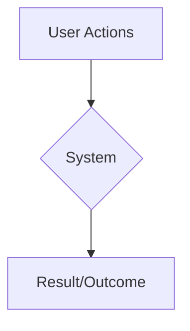
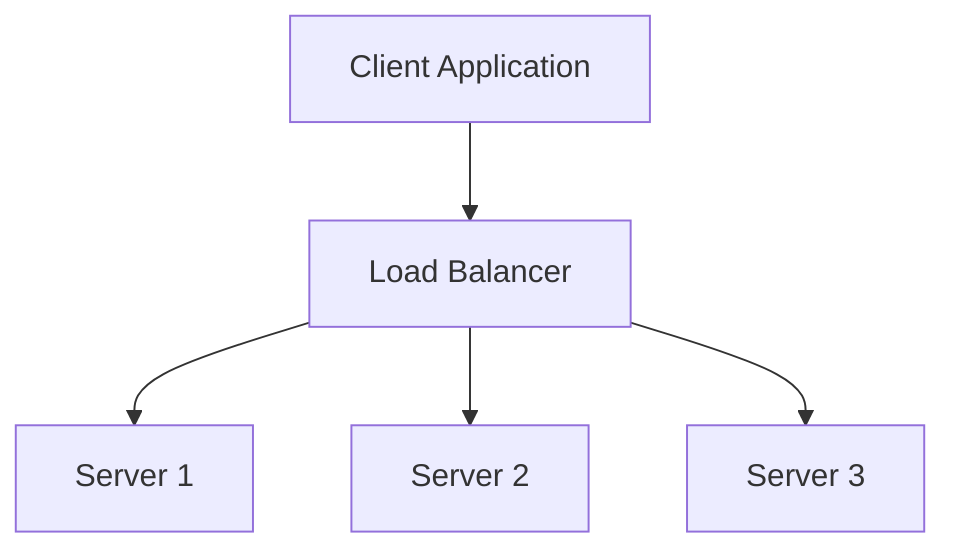
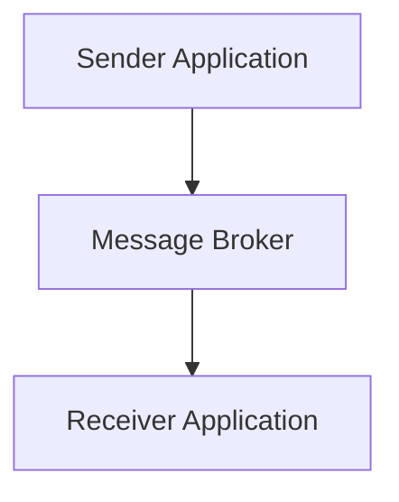
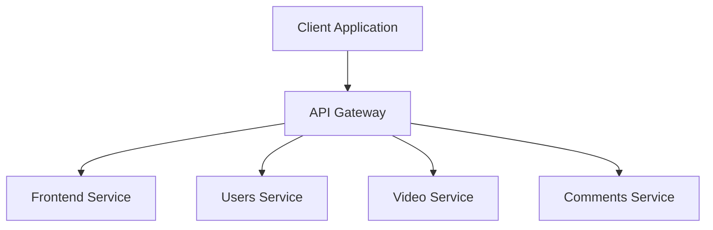
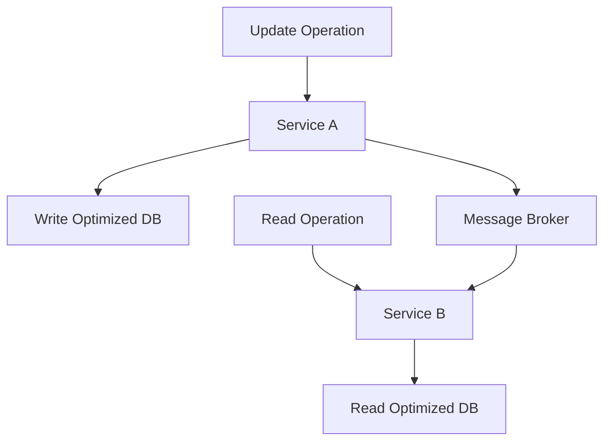
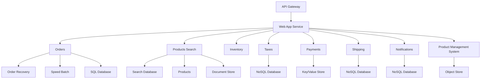

# Software Architecture & Design of Large Scale Systems - Notes

## 1. Introduction to System Requirements & Architectural Drivers
Requirements
A formal description of what the system needs to do.

Functional Requirements: Features and behaviors of the system, such as user actions and system outcomes.

Non-Functional Requirements (Quality Attributes): How well the system performs, dictating its architecture. Examples include:

Performance: How fast the system responds.

Scalability: The ability to handle growth in work.

Availability: The uptime and accessibility of the service.

Reliability: The probability of the system to perform as expected.

Security: Protection against unauthorized access.

System Constraints: Pre-existing decisions or limitations that restrict architectural choices, such as technical, business, or regulatory constraints.

Diagrams
The book mentions that functional requirements relate to user actions and system outcomes. Here's a simple diagram to illustrate this relationship.

2. Most Important Quality Attributes
Performance
Response Time: The total time from when a client sends a request to when it receives a response.

Response Time = Processing Time + Waiting Time

Throughput: The amount of work or data processed by the system per unit of time.

Percentiles: Used to measure performance distribution and identify "tail latency," which is the small percentage of requests that take the longest.

Scalability
The ability of a system to handle a growing amount of work by adding resources.

Vertical Scalability (Scale Up): Adding more resources to a single machine (e.g., more CPU, RAM).

Horizontal Scalability (Scale Out): Adding more machines to the system. This is often preferred for large-scale systems.

Team/Organizational Scalability: How the software architecture impacts the productivity of the engineering team.

Availability
The fraction of time a service is functional and accessible.

Availability = Uptime / (Uptime + Downtime)

MTTR (Mean Time to Recovery): The average time it takes to recover from a failure.

Fault Tolerance: The ability of a system to remain operational despite failures in one or more components. This is achieved through:

Redundancy and Replication: Having multiple copies of components.

Failure Detection and Isolation: Using health checks and monitoring.

Recovery: Mechanisms to restore a failed component.

3. API Design
API (Application Programming Interface): A contract for communication between different parts of a system.

Idempotency: An operation that can be performed multiple times without changing the result beyond the initial execution.

REST API:

An architectural style for networked applications.

Uses standard HTTP methods (GET, POST, PUT, DELETE) to interact with named resources (nouns).

RPC (Remote Procedure Call):

A protocol that allows a program to call a procedure on a remote machine as if it were a local function.

Often uses an Interface Description Language (IDL) and stubs to abstract the communication details.

4. Architectural Building Blocks
Load Balancer
Distributes incoming network traffic across a group of backend servers to ensure no single server is overwhelmed.

Message Broker
A software component that facilitates asynchronous communication between applications by using a message queue.

API Gateway
A single entry point for all client requests, handling tasks like security, routing, and monitoring before forwarding requests to the appropriate backend services.

Content Delivery Network (CDN)
A globally distributed network of servers that caches static content (like images and videos) closer to the end-users to speed up delivery.

5. Data Storage
Relational Databases
Organize data in tables with a predefined schema.

Support ACID transactions (Atomicity, Consistency, Isolation, Durability) which are crucial for data integrity.

Non-Relational Databases (NoSQL)
Store data without a fixed schema.

Key/Value Store: Stores data as a collection of key-value pairs.

Document Store: Stores data in flexible, semi-structured documents (e.g., JSON).

Graph Database: Optimized for relationships between data points.

Database Scaling Techniques
Replication: Creating multiple copies of the database to improve availability and read performance.

Partitioning/Sharding: Dividing a large database into smaller, more manageable parts across different servers.

6. Software Architecture Patterns
Multi-Tier Architecture
Divides an application into logical tiers: Presentation, Application, and Data. This allows for horizontal scaling of each tier independently.

Microservices Architecture
A style that structures an application as a collection of small, independently deployable, loosely coupled services.

Each service often has its own separate database.

Event-Driven Architecture
A pattern where system components communicate by producing and consuming events.

Event Sourcing: The application state is determined by a sequence of events.

CQRS (Command Query Responsibility Segregation): Separates the data model for read operations (queries) from the data model for write operations (commands).

Big Data Architecture Patterns
Batch Processing: Processing large volumes of data that have been collected over a period of time.

Real-Time Processing: Processing data as it is generated, often in streams.

Lambda Architecture: Combines both batch and real-time processing to provide a comprehensive view of data.

7. System Design Practice - E-Commerce Marketplace
Functional Diagram
This diagram shows the high-level services and their interactions.

