# Software Architecture & Design of Large Scale Systems Notes

-----

## **Introduction to System Requirements & Architectural Drivers**

**Requirements** are a formal description of what needs to be built. There are three main types of requirements that act as architectural drivers:

  * **Features of the System**: These are the functional requirements. A system takes in user actions and events to produce a result or outcome.
  * **Quality Attributes**: These are non-functional requirements that dictate the software architecture. Examples include:
      * Scalability
      * Availability
      * Reliability
      * Security
      * Performance
  * **System Constraints**: These are the limitations and boundaries of the system.

-----

## **Feature Requirements - Step-by-Step Process**

Methods for gathering requirements include using **use cases** (scenarios in which the system is used) and **user flows** (step-by-step or graphical representations of each use case).

The steps for gathering requirements are:

1.  Identify all actors/users in the system.
2.  Capture and describe all possible use cases/scenarios.
3.  Expand each use case through the flow of events in a user flow. Each event contains an action and data.

A **Sequence Diagram** is a diagram that shows the interactions between actors and objects.

Here's an example of a sequence diagram:

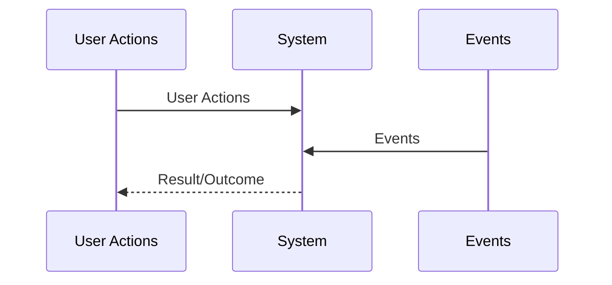

-----

## **System Quality Attributes Requirements**

Quality attributes are a measure of how well a system performs on a particular dimension. They have a direct correlation with the system's architecture.

Key considerations for quality attributes:

  * **Testability and Measurability**: Quality attributes must be testable and measurable.
  * **Trade-Offs**: No single architecture can provide all quality attributes, as some can contradict each other.
  * **Feasibility**: It's important to ensure the system can actually deliver what the client is asking for.

-----

## **System Constraints in Software Architecture**

A **system constraint** is a pre-made decision that limits a system's degrees of freedom.

Types of constraints include:

  * Technical constraints
  * Business constraints
  * Regulatory/legal constraints (global or specific to a region)

Constraints can force sacrifices in architecture and implementation. It's recommended to use a **loosely coupled architecture** to handle constraints.

-----

## **Most Important Quality Attributes in Large-Scale Systems**

### Performance

**Performance** is measured by **Response Time** and **Throughput**.

  * **Response Time**: The total time from a client sending a request to receiving a response.
      * `Response Time = Processing Time + Waiting Time`.
      * **Waiting Time** is the time a request spends idle in the system.
      * **Tail Latency** refers to the small percentage of response times that are the longest compared to the rest.
  * **Throughput**: The amount of work or data processed by the system per unit of time. It's measured in tasks per second or bits/bytes per second.

Here is a diagram showing the relationship between processing and waiting time in response time:

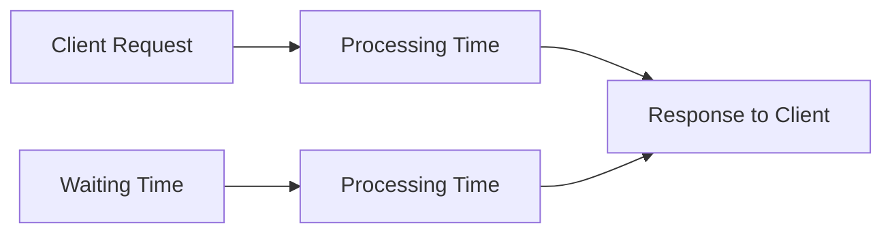

### Scalability

**Scalability** is the ability of a system to handle more work, easily and cost-effectively, by adding resources to the system.

Types of scalability:

  * **Vertical Scalability (Scale Up)**: Adding or upgrading resources on a single computer.
  * **Horizontal Scalability (Scale Out)**: Adding more resources in the form of new instances on different machines.
  * **Team/Organizational Scalability**: How the software architecture impacts team productivity.

### Availability

**Availability** is the fraction of time a service is functional and accessible to users.

  * `Availability = Uptime / (Uptime + Downtime)`
  * **Uptime**: The time the system is operational and accessible.
  * **Downtime**: The time the system is unavailable.
  * Availability can also be calculated as: `Availability = MTBF / (MTBF + MTTR)`. MTTR stands for Mean Time to Recovery.

### Fault Tolerance

**Fault Tolerance** enables a system to stay operational despite failures in its components.

Sources of failure include:

  * Human error
  * Software errors
  * Hardware failures

Tactics for achieving fault tolerance include:

  * **Failure Prevention**: Using redundancy and replication.
  * **Failure Detection and Isolation**: Using monitoring and health checks.
  * **Recovery**: Stopping traffic to the failed instance, restarting the host, or rolling back.

### SLA, SLO, SLI

  * **SLA (Service Level Agreement)**: A legal contract that defines the quality of service.
  * **SLO (Service Level Objectives)**: Target values or ranges that the service needs to meet.
  * **SLI (Service Level Indicators)**: Quantitative measures of compliance with SLOs.

Important considerations for SLOs and SLIs:

  * Don't set an SLO for every measurable SLI.
  * Promise fewer, more realistic SLOs and include a budget for error.
  * Have a recovery plan for when SLOs aren't met.

-----

## **API Design**

An **API (Application Programming Interface)** is a contract between the engineers who implement the system and the client applications that use it.

Categories of APIs:

  * Public APIs
  * Private/Internal APIs
  * Partner APIs

API best practices include:

  * Encapsulating internal design.
  * Making the API easy to use.
  * Ensuring operations are **idempotent** (performing an operation multiple times doesn't change the result).
  * Using API pagination.
  * Handling asynchronous operations.
  * Versioning the API.

### RPC (Remote Procedure Call)

**RPC** makes a remote procedure call look like a local method call. RPC frameworks support multiple programming languages. The details of communication and data transfer are abstracted away from the developer.

Drawbacks compared to local method invocation are that RPC is slower and less reliable.

Here is a diagram of RPC:

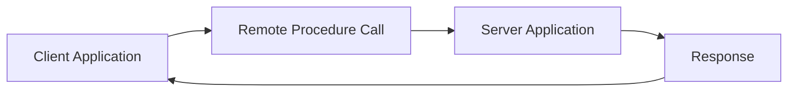

### REST API

**REST (Representational State Transfer)** is a set of architectural constraints for web APIs.

Key concepts:

  * **HATEOAS** (Hypermedia as the Engine of the Application State): A dynamic interface.
  * **Statelessness**: No client state is stored on the server between requests.
  * **Cacheability**: Responses can be cached to improve performance.
  * **Named Resources**: Resources are either simple or collection resources.

REST API best practices for resources:

  * Use nouns for resource names.
  * Distinguish between collection and simple resources.
  * Use clear and meaningful names.
  * Ensure unique and URL-friendly identifiers.

REST API operations are mapped to HTTP methods:

  * **Create** a new resource -\> `POST`.
  * **Update** an existing resource -\> `PUT`.
  * **Delete** an existing resource -\> `DELETE`.
  * **Get** the state of a resource -\> `GET`.
  * **List** sub-resources of a collection -\> `GET`.

-----

## **Large Scale Systems Architectural Building Blocks**

### DNS, Load Balancing & GSLB

The role of a **Load Balancer (LB)** is to distribute incoming requests among a group of servers to prevent any single server from becoming overwhelmed.

Types of load balancers:

  * **DNS Load Balancing**: Uses DNS records to distribute traffic.
  * **Hardware Load Balancing**: Runs on dedicated, optimized hardware.
  * **Software Load Balancing**: Programs that run on general-purpose computers.
  * **Global Server Load Balancing (GSLB)**: Distributes traffic across servers in different geographical locations.

Here is a diagram showing a load balancer distributing requests to a group of servers:

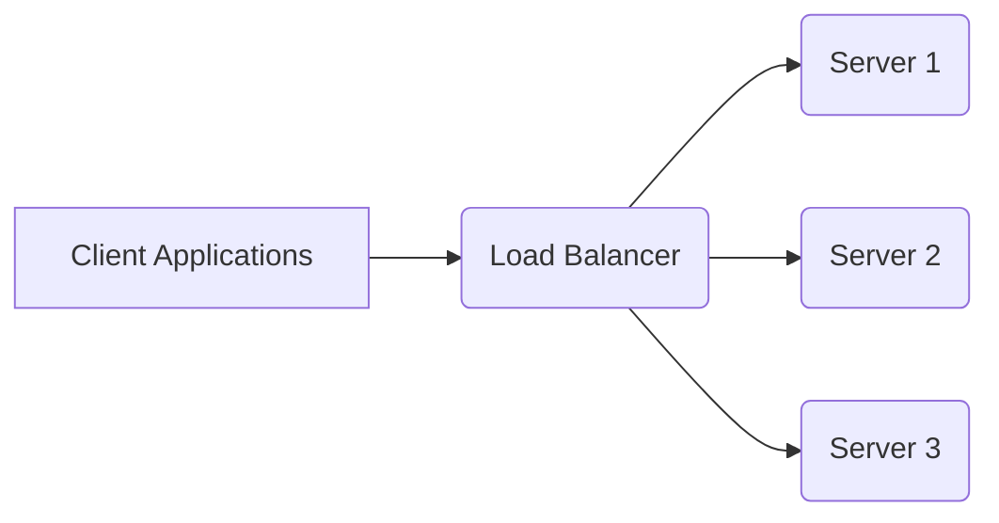

### Message Brokers

A **message broker** is an architectural component that uses a queue to store messages between senders and receivers, facilitating **asynchronous communication** within a system.

Benefits:

  * Services can publish messages to a channel.
  * Services can subscribe to a channel and get notified when a new event is published.

Here is a diagram of a message broker:

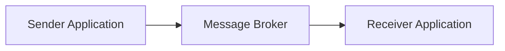

### API Gateway

An **API Gateway** follows the "API composition" pattern, allowing clients to call a single service that, in turn, routes requests to multiple backend services.

Benefits:

  * Seamless internal modifications and refactoring.
  * Consolidates security, authorization, and authentication in one place.
  * Handles request routing.
  * Performs static content and response caching.
  * Offers monitoring and alerting capabilities.
  * Can perform protocol translation.

Considerations:

  * It should not contain business logic.
  * It can become a single point of failure.
  * External services shouldn't bypass it.

Here is a diagram showing the API Gateway pattern:

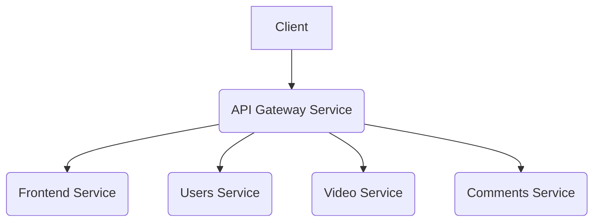

### Content Delivery Network (CDN)

A **Content Delivery Network (CDN)** is a globally distributed network of servers designed to speed up the delivery of content to end-users.

Content publishing strategies:

  * **Pull Strategy**: The CDN "pulls" content from the origin server when a user requests it.
  * **Push Strategy**: The origin server "pushes" content to the CDN proactively.

Here is a diagram of the pull strategy:

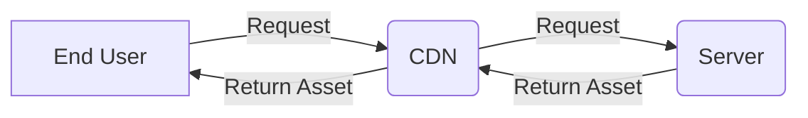

-----

## **Data Storage at Global Scale**

### Relational Databases & ACID Transactions

Relational databases have a predefined schema, giving developers knowledge of what each record must contain.

Advantages:

  * Ability to form complex and flexible queries.
  * Efficient storage.
  * Natural structure for humans to understand.
  * Support **ACID transactions**.
      * **Atomicity**: A set of operations either all appear at once or don't appear at all.
      * **Consistency**: A committed transaction is seen by all future queries and does not violate any constraints.
      * **Isolation**: Deals with concurrent operations and their effects on each other.
      * **Durability**: Once a transaction is complete, its final state persists permanently in the database.

### Non-Relational Databases

Non-relational databases (NoSQL) are categorized by their data models.

  * **Key/Value Store**: Stores data as a key-value pair.
  * **Document Store**: Stores collections of documents, where each document is an object with different attributes.
  * **Graph Database**: Optimized for navigating and analyzing relationships between records.

### Techniques to Improve Database Performance, Availability & Scalability

  * **Database Indexing**: Creates an index to allow for faster data retrieval from a table.
  * **Database Replication**: Creates multiple copies (replicas) of a database to improve availability and read performance.
  * **Database Partitioning/Sharding**: Divides a large database into smaller, more manageable parts called shards or partitions.

### Brewer's (CAP) Theorem

The **CAP Theorem** states that in the presence of a network partition, a distributed database can only guarantee either **Consistency** or **Availability**, but not both.

  * **Consistency**: Every read request receives the most recent write or an error.
  * **Availability**: Every request receives a non-error response, without the guarantee that it contains the most recent write.

-----

## **Software Architecture Patterns**

### Multi-Tier Architecture

This pattern separates an application into multiple tiers, such as a presentation tier, application tier (logic/business tier), and a data tier.

  * **Advantages**: Fits a variety of use cases and is easy to scale horizontally.
  * **Drawback**: The logic tier can become monolithic.

Here is a diagram of the Multi-Tier Architecture:

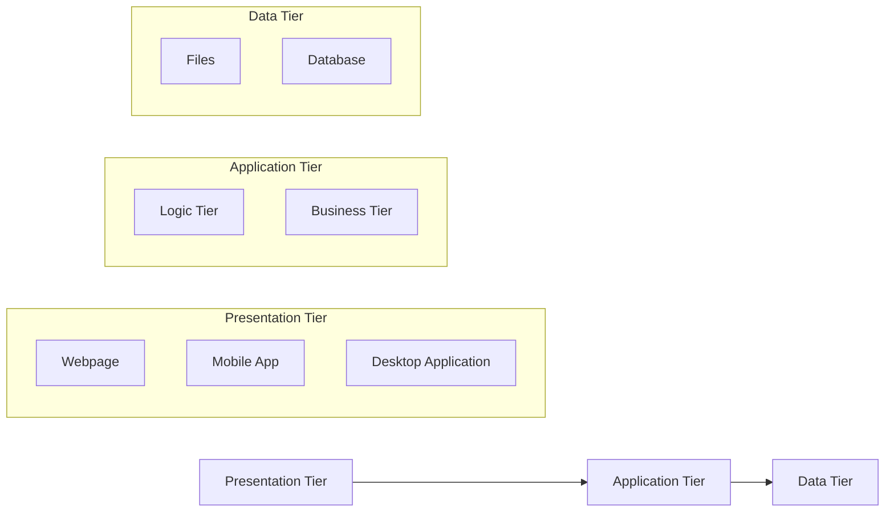

### Microservices Architecture

In a **Microservices Architecture**, business logic is organized into loosely coupled, independently deployed services.

Best practices include:

  * Following the Single Responsibility Principle for each service.
  * Using a separate database for each service.

Here is a diagram of Microservices Architecture:

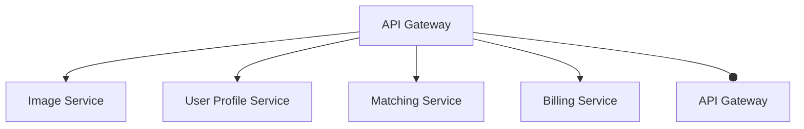

### Event-Driven Architecture

An **event** is an immutable statement of a fact or a change. In an event-driven architecture, services communicate by publishing and consuming events, often using a message broker.

Here is a diagram of the Event-Driven Architecture pattern:

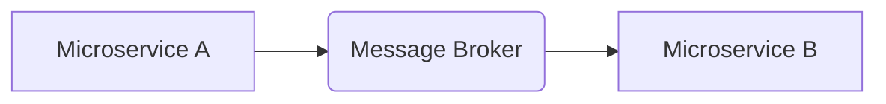

-----

## **Design a Highly Scalable Discussion Forum**

### Functional Architecture Diagram

Below is the functional architecture diagram for a highly scalable discussion forum:

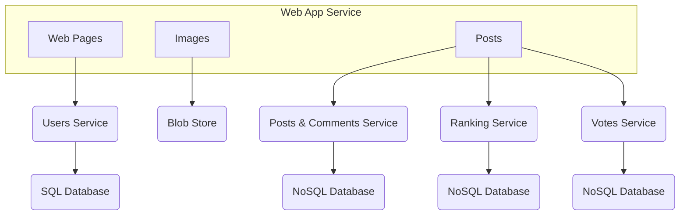

-----

### Final Software Architecture

Below is the final software architecture diagram for a highly scalable discussion forum:

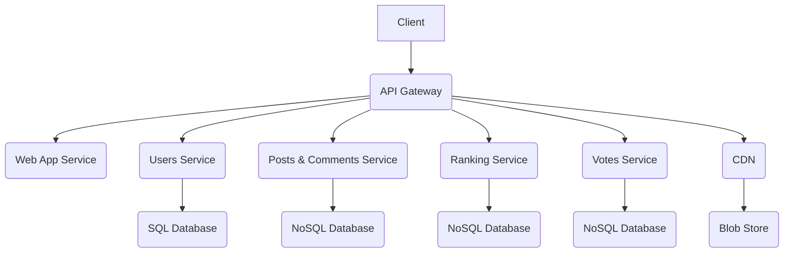

-----

## **Design an E-Commerce Marketplace Platform**

### Functional Diagram

Below is the functional diagram for an e-commerce marketplace platform:

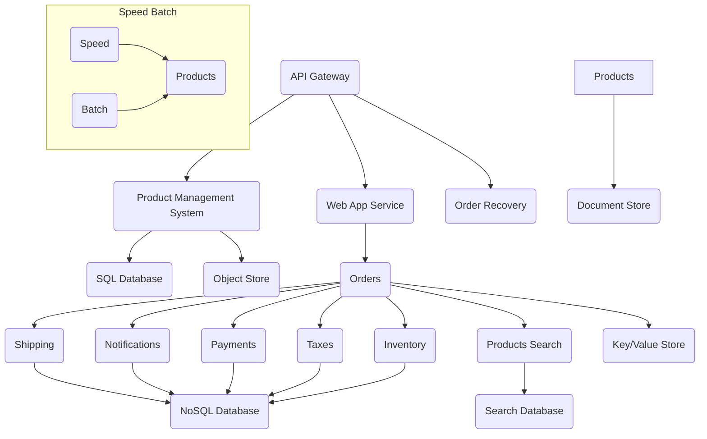